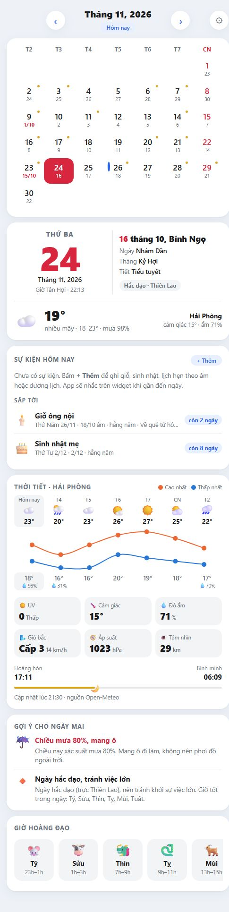

# Lịch âm & Thời tiết — widget Android

Widget cho màn hình chính Android hiện cùng lúc lịch âm, thời tiết và một dòng gợi ý hôm nay nên làm gì. Kèm app xem ngày, sự kiện âm/dương lịch và nhắc việc. Không quảng cáo, không tài khoản, dữ liệu nằm trên máy.

Lịch âm tính offline theo thuật toán Hồ Ngọc Đức. Thời tiết lấy từ Open-Meteo (miễn phí, không cần key).

## Xem trước

Widget 4×2 ở 5 trạng thái (đêm, sáng sớm ngày rằm, ban ngày, chiều tà, trời mưa):


Màn hình app (số liệu thời tiết là mẫu):

| Màn hình chính | Thêm sự kiện | Cài đặt |
|---|---|---|
|  |  |  |

## Tính năng

**Widget**
- Bốn cỡ, mỗi cỡ một thiết kế: 2×2 "Vầng trăng" (trăng to, ngày âm, nhiệt độ), 3×2 "Tờ lịch" (số ngày dương lớn, ngày âm kèm trăng, thời tiết, gợi ý), 4×2 "Bầu trời" (ngày âm kèm trăng, Tết/hoàng đạo, thời tiết, gợi ý), 4×4 "Toàn cảnh" (thêm dự báo 3 ngày và sự kiện sắp tới). Kéo giãn widget là tự đổi bố cục (Android 12+ do launcher chọn theo kích thước thật).
- Qua 0h widget tự đổi sang ngày mới (không đánh thức máy, vẽ lại khi bạn mở màn hình).
- Nền là bầu trời đổi theo giờ mặt trời mọc/lặn của thành phố đã chọn (đêm có sao, sáng sớm, ban ngày, chiều tà có quầng nắng, xám xanh khi mưa), điểm mây cát tường dạng khối. Kiểu 3D: tấm nền có cạnh dày, viền sáng vát cạnh, ánh sáng loang từ trên; ô gợi ý là kính khói nổi.
- Ngày âm chữ có chân (serif) đi cùng hình trăng vẽ đúng tuần trăng; ngày rằm, mùng 1, lễ Tết đổi chữ vàng; đếm ngược Tết trong 90 ngày cuối năm.
- Dòng gợi ý theo thứ tự ưu tiên: sự kiện cá nhân → cảnh báo thời tiết → rằm/mùng 1/lễ → tiết khí → hoàng đạo. Sau 18h nói về ngày mai.
- Chạm vào nhiệt độ mở thẳng thẻ thời tiết, chạm phần còn lại mở lịch.
- Widget 1×1 "Lịch hôm nay": tập lịch bloc 3D cỡ một biểu tượng (tờ chồng tạo độ dày, gáy đỏ son bóng có vòng gáy vàng kim, thứ trên gáy, ngày dương in chìm, ngày âm kèm trăng 3D đúng tuần trăng; số đỏ vào Chủ nhật, lễ, rằm, mùng 1; có biểu tượng khi hôm nay có sự kiện), tự đổi lúc 0h. Android không cho app tự đổi số ngày trên icon, nên đặt widget này thay icon app để có biểu tượng lịch đổi theo ngày. Trong app: Cài đặt → Widget → Thêm tờ lịch 1×1.

- Widget "Lịch bloc": tờ lịch ngày kiểu bloc truyền thống (tháng năm trên gáy đỏ, thứ, ngày lớn, ngày âm kèm trăng, can chi ngày tháng) kèm một câu ca dao, tục ngữ mỗi ngày (120 câu dân gian, đi hết vòng mới lặp). Ghim nhanh trong Cài đặt → Widget. Chạm vào widget là mở lịch xé.

**Lịch xé** (Tiện ích → Lịch xé, hoặc chạm widget "Lịch bloc")
- Tập lịch bloc dựng bằng Jetpack Compose: gáy đỏ có đinh tán, tờ giấy có thớ, mép răng cưa còn dính dưới gáy sau mỗi lần xé.
- Kéo tờ trên cùng xuống hoặc sang ngang: vết nứt răng cưa chạy dần dọc đường xé từ mép phía tay kéo sang mép kia (lòng khe tối, mép rách trắng có xơ giấy, vệt căng mờ trước đầu vết nứt), phần chưa rách vẫn dính dưới gáy, tờ chỉ hé ra và bong nhẹ về phía trước; rách gần hết mới xoay theo tay. Kèm tiếng giấy sột soạt và rung nhẹ mỗi nấc vết nứt chạy thêm. Dải giấy của tờ vừa xé ở lại dưới gáy đúng theo đường rách. Thả đủ xa hoặc vuốt nhanh thì tờ rời gáy, bay theo mô phỏng vật lý (giữ vận tốc lúc vuốt, trọng lực, lực cản không khí, xoay chậm dần, tờ giấy rung lật 3D) rồi mờ dần; không đủ thì tờ bật về như lò xo. Có nút "Xé tờ", "Hôm qua", "Hôm nay", tắt tiếng; máy để im lặng / rung thì không phát tiếng.
- Tiếng giấy là âm thanh tự tổng hợp (nhiễu lọc dải và chuỗi xung thớ giấy đứt), không lấy từ nguồn ngoài.

**Màn hình khóa & hình nền**
- Lịch trên màn hình khóa: một thông báo im lặng (không kêu, không rung, không hiện nổi) luôn có ngày âm và câu ca dao hôm nay, tự đổi lúc 0h; máy có màn hình luôn bật (AOD) hiện thông báo thì thấy cả ở đó. Bật trong Cài đặt → Màn hình khóa & hình nền.
- Hình nền động "Lịch âm · trời trăng" (màn hình chính và màn hình khóa): trời đổi màu theo giờ mọc, lặn thật của thành phố đang chọn; trăng vẽ đúng tuần trăng theo ngày âm (rằm tròn vành vạnh, đầu tháng lưỡi liềm) có bóng trăng trên mặt nước; hiệu ứng theo tiết khí: hoa đào bay mùa xuân, mưa phùn Vũ thủy, mưa rào Cốc vũ, đom đóm đêm hè, lá vàng rơi mùa thu, sương mỏng Bạch lộ / Hàn lộ, sương mù từ Sương giáng đến Đại hàn (Đông chí sương mù dày). Đang mưa hay có sương mù thật thì theo thời tiết. Núi trôi nhẹ khi vuốt giữa các trang màn hình chính; tùy chọn hiện ngày âm trên hình nền. Chỉ chuyển động khi đang hiện, tiết kiệm pin thì đứng yên.

**Icon app**
- Tập lịch bloc 3D trên nền trời đêm: tờ chồng, gáy đỏ son bóng, vòng gáy vàng kim, lưới ngày với ngày hôm nay là vầng trăng vàng phát sáng; có lớp đơn sắc cho icon theo chủ đề (Android 13+).

**Màn hình app**
- Thanh menu dưới năm mục: Lịch (lưới tháng, thẻ ngày, gợi ý, ghi chú, sự kiện), Thời tiết, Xem ngày (giờ hoàng đạo, việc nên làm, chọn ngày tốt, xem tuổi, Tết & tử vi; có nút sang ngày trước / sau), Tiện ích, Cài đặt. Mỗi mục nhớ chỗ đang cuộn, chạm lại mục đang mở để lên đầu trang; nút Quay lại của máy đóng bảng đang mở rồi về mục Lịch. Chạm vùng thời tiết trên widget mở thẳng mục Thời tiết.
- Icon nét bộ Lucide (đóng gói sẵn trong app, không tải qua mạng), mỗi mục một màu nhấn; giờ hoàng đạo và tuổi ghi địa chi bằng chữ Hán. Sự kiện vẫn lưu biểu tượng dạng emoji nên widget và thông báo hiển thị như cũ.
- Lưới tháng có ngày âm dưới ngày dương, chấm vàng ngày hoàng đạo; ngày có sự kiện tô nhạt và hiện biểu tượng sự kiện ở góc ô (ngọn lửa cho giỗ, bánh kem cho sinh nhật..., kèm số nếu có nhiều sự kiện); thu gọn thành một hàng tuần được.
- Giao diện 3D (ánh sáng từ góc trên trái): thẻ và nút nổi khối, chạm thì lún xuống; ô hôm nay là nút đỏ nổi; chấm hoàng đạo là hạt vàng; trăng hình cầu, mây khối; số ngày trên khung trời có độ dày; khung trời nghiêng nhẹ và các lớp sao, trăng, mây dịch theo chiều sâu khi nghiêng máy hoặc rê ngón tay.
- Mở app: màn chờ trời đêm có trăng thay cho màn trắng, rồi thẻ ngày hiện dần như một khung trời theo giờ (cùng màu với widget), trăng nhô lên đúng tuần trăng của ngày đang xem, mây cát tường trôi vào, sao lấp lánh ban đêm; các thẻ khác lần lượt hiện. Máy bật "giảm chuyển động" thì không chạy hiệu ứng.
- Thẻ ngày: số ngày lớn, giờ can chi hiện tại, ngày/tháng/năm can chi, tiết khí, hoàng/hắc đạo, tuần trăng, hợp/xung với tuổi bạn (nếu đã nhập năm sinh).
- Ghi chú nhanh theo ngày: danh sách việc cần làm ngay dưới thẻ ngày đang chọn (thêm, đánh dấu xong, xóa); ngày còn việc chưa xong có gạch xanh dưới ô lịch. Ghi chú có trong file sao lưu.
- Câu ca dao, tục ngữ của ngày ở cuối thẻ ngày (cùng câu với widget "Lịch bloc").
- Sự kiện: giỗ, sinh nhật, lịch hẹn theo âm hoặc dương lịch, lặp hằng năm, giờ, nhắc trước. Chọn ngày âm thì hiện luôn rơi vào ngày dương nào; giỗ 30 âm gặp tháng thiếu tự tính vào 29; sự kiện 29/2 dương lịch năm không nhuận tính vào 28/2.
- Thời tiết 7 ngày: đường nhiệt độ cao nhất/thấp nhất, UV, cảm giác, độ ẩm, gió (hướng + cấp Beaufort), áp suất, tầm nhìn, thanh bình minh–hoàng hôn. Lưu nhiều thành phố, chuyển bằng chip.
- Gợi ý hôm nay / cho ngày mai.
- Xem ngày: trực (thập nhị kiến trừ) với việc nên làm, không nên; sao Nhị thập bát tú (tốt/xấu, nên/kỵ); sao tốt, sao xấu theo Ngọc Hạp thông thư (chạm tên sao để xem ý nghĩa); ngũ hành nạp âm; tuổi xung; hướng xuất hành (Hỷ thần, Tài thần); giờ xuất hành Lục Diệu.
- Xem tuổi làm nhà, cưới hỏi: Kim Lâu, Hoang Ốc, Tam Tai, Thái Tuế cho 5 năm tới, theo năm sinh trong hồ sơ hoặc chọn năm khác (ví dụ tuổi cô dâu).
- Chọn ngày tốt: cưới hỏi, khai trương, khởi công, nhập trạch, ký hợp đồng, mua xe, xuất hành, cúng lễ — chấm điểm theo hoàng đạo, trực, Lục Diệu, sao Nhị thập bát tú, loại ngày trực xấu và ngày xung tuổi.
- Tết & tử vi: đếm ngược tới Tết theo ngày, giờ, phút; tuổi xông đất Tết năm tới theo năm sinh gia chủ (điểm 0–100 xét thiên can, địa chi, mệnh nạp âm với gia chủ và với năm mới, kèm lưu ý Tam Tai, Thái Tuế và tuổi nên tránh); cung hoàng đạo, con giáp, mệnh nạp âm theo ngày sinh trong hồ sơ.
- Văn khấn cổ truyền (offline): mùng 1, ngày rằm, gia tiên, giỗ, khai trương, giao thừa ngoài trời / trong nhà, ông Công ông Táo, nhập trạch, Thần Tài. Tự điền ngày âm (theo ngày đang chọn), tên tín chủ, năm sinh, tuổi; chỗ còn lại để trống cho người dùng tự điền. Mỗi bài đối chiếu 3–5 nguồn.
- La bàn phong thủy AR (Compose + CameraX + cảm biến xoay): giơ camera lên, các hướng hiện ngay đúng chỗ trong khung hình (thẻ hướng neo trên đường chân trời, hướng ngoài khung có mũi tên ở mép kèm số độ cần xoay, thước 24 sơn ở dưới). Bốn chế độ: Bàn thờ (4 hướng tốt Sinh Khí, Thiên Y, Diên Niên, Phục Vị để bàn thờ quay mặt về và 4 hướng xấu để tựa lưng, theo Bát trạch và cung phi của gia chủ), Xuất hành (Hỷ thần, Tài thần hôm nay), Tài lộc (hướng Sinh Khí của gia chủ và Tài thần hôm nay), Tám hướng. Cúi máy nằm ngang hoặc không cho quyền camera thì thành la bàn phẳng 24 sơn tô tám cung tốt xấu. Báo khi la bàn cần hiệu chỉnh (xoay hình số 8).
- Sổ giỗ gia đình: tạo sổ (Nhà nội, Nhà ngoại…), ghi ngày giỗ âm lịch của từng người, năm mất, nơi an táng, người lo đồ cúng, ghi chú; ngày giỗ thành sự kiện âm lịch lặp hằng năm, hiện trên lịch, widget và được nhắc trước (chọn số ngày). "Gửi cho cả nhà" gửi qua Zalo, Messenger một tin nhắn có danh sách dễ đọc và một mã; người nhận mở Sổ giỗ gia đình → Nhập mã, dán tin nhắn là có cả sổ trên máy mình. Sửa (đổi người lo đồ cúng, thêm, xóa) rồi gửi lại: mỗi người lấy bản sửa sau cùng, việc xóa cũng được truyền đi. Không cần tài khoản hay máy chủ; sổ có trong file sao lưu.
- Chế độ Zen ("Lịch Mù"): toàn màn hình nền giấy dó (có thớ giấy) hoặc mực đen, chỉ một con số ngày âm và một câu thơ mỗi ngày: 62 bài thơ ba dòng kiểu haiku viết riêng cho app và 44 trích đoạn thơ cổ Việt Nam đã hết thời hạn bảo hộ (Nguyễn Du, Nguyễn Khuyến, Bà Huyện Thanh Quan, Nguyễn Trãi, Hàn Mặc Tử, Nguyễn Bính, thơ thiền Trần Nhân Tông, Mãn Giác qua bản dịch Ngô Tất Tố…), mỗi đoạn đối chiếu nguyên văn ở hai nguồn. Vuốt ngang để đổi ngày, chạm để hiện nút. Có thể đặt mở app thẳng vào chế độ Zen.
- Đổi lịch âm ↔ dương; chia sẻ ảnh "Hôm nay" lên Zalo, Facebook.
- Hồ sơ: họ tên và ngày sinh (nhập theo âm hoặc dương lịch, hiện luôn ngày quy đổi). Tuổi can chi tính theo năm âm của ngày sinh, nên người sinh tháng 1–2 trước Tết vẫn đúng tuổi, dùng để xét hợp/xung tuổi và xem tuổi. Sinh nhật của bạn tự hiện trong sự kiện sắp tới, trên widget và được nhắc như sự kiện khác; app chào theo tên. Bật/tắt từng mục hiển thị, chọn giao diện sáng/tối, chọn hình nền lịch (tranh tự vẽ: hoa sen, vịnh Hạ Long, hoa đào, ruộng bậc thang, cá chép trông trăng theo phong cách tranh dân gian; hoặc ảnh của bạn).

**Thông báo**
- Nhắc sự kiện sắp tới vào giờ bạn chọn (mặc định 7:00), nhắc rằm/mùng 1/lễ Tết (hôm trước và đúng ngày), cảnh báo thời tiết ngày mai lúc 20:00 (mưa, dông, rét, nắng nóng).
- ColorOS hay chặn thông báo và chạy nền của app cài ngoài: vào Cài đặt máy → Thông báo và Pin → cho phép app. Trong app có nút "Gửi thông báo thử" để kiểm tra.

**Dữ liệu**
- Sao lưu sự kiện ra file JSON và khôi phục lại.
- Google Calendar (Tiện ích → Google Calendar): nút "Chọn tài khoản Google" mở bảng chọn tài khoản của máy (tài khoản đã có trên máy, hoặc thêm tài khoản bằng màn hình đăng nhập của Google, app không thấy mật khẩu). Chọn xong app tự bật đồng bộ Lịch cho tài khoản đó nếu đang tắt và đồng bộ ngay, rồi hiện các lịch khi đã về máy; máy thiếu phần đồng bộ Lịch Google (đi kèm ứng dụng Lịch Google, hay gặp trên máy OPPO / realme) thì app báo và có nút mở CH Play. Mỗi tài khoản có trạng thái đồng bộ (đang tắt thì có nút Bật) và nút đồng bộ ngay. Nhập sự kiện 1 năm tới từ lịch đang chọn vào app; bật "Tự lấy sự kiện mới" thì app tự lấy lại vài giờ một lần và mỗi lần mở app, sự kiện đã xóa hay dời ngày bên Google cũng được cập nhật (sự kiện đã qua giữ lại). Xuất sự kiện của app, kể cả giỗ âm lịch, thành từng ngày trong 5 năm tới sang lịch Google đã chọn; xuất lại thì thay các mục đã xuất lần trước, sự kiện vừa nhập không bị xuất ngược. Cần quyền Lịch, chỉ xin khi bấm.
- Xuất sự kiện sang Google Calendar bằng file .ics (mỗi lần diễn ra trong 5 năm là một mục, vì Google Calendar không lặp theo âm lịch).

## Build APK bằng GitHub (không cần cài Android Studio)

1. Tạo repo mới trên GitHub (Public hoặc Private đều được).
2. Đẩy code lên:

   ```bash
   git remote add origin https://github.com/<tên-bạn>/lich-am-widget.git
   git push -u origin main
   ```

3. Vào tab **Actions** của repo, chờ job "Build APK" chạy xong (khoảng 5–8 phút lần đầu).
4. Vào tab **Releases**, tải file `LichThoiTiet.apk` về điện thoại rồi cài.
   Lần đầu ColorOS sẽ hỏi cho phép cài từ nguồn không xác định, bấm cho phép.
5. Giữ lâu trên màn hình chính → Widget → "Lịch âm & Thời tiết", hoặc trong app vào Cài đặt → "Thêm widget vào màn hình chính".

Mỗi lần sửa code và `git push`, GitHub tự build bản mới (sửa `docs/` hay README thì không build). Chỉ nhánh `main` mới tạo Release; nhánh khác vẫn build và để APK ở mục Artifacts của lần chạy trong tab Actions. Các bản sau cài đè được lên bản trước vì dùng chung khóa ký.

## Xem trước giao diện trên máy tính

Mở `app/src/main/assets/index.html` bằng trình duyệt (hoặc chạy `python -m http.server` trong thư mục đó rồi mở `http://localhost:8000`). Khi không chạy trong app, trang tự nạp `mock.js` để giả lập cầu nối `Android`: ngày âm tính thật, còn thời tiết, trực, giờ tốt, sao Ngọc Hạp là số liệu mẫu. Trong app thật `mock.js` không được tải.

## Cấu trúc

| File | Vai trò |
|---|---|
| `LunarCalendar.kt` | Đổi dương ↔ âm, can chi, hoàng đạo, giờ tốt, tiết khí, tuần trăng, Tết tiếp theo |
| `Almanac.kt` | Trực ngày, việc nên/kỵ, nạp âm, tuổi hợp/xung, hướng xuất hành, Lục Diệu, Nhị thập bát tú, xem tuổi (Kim Lâu, Hoang Ốc, Tam Tai), chọn ngày tốt |
| `NgocHap.kt` | Sao tốt, sao xấu theo Ngọc Hạp thông thư (bảng quy tắc sinh tự động, xem mục Nguồn tính toán) |
| `NoteStore.kt` | Ghi chú việc cần làm theo ngày |
| `Quotes.kt` | 120 câu ca dao, tục ngữ và cách chọn câu cho từng ngày |
| `CalendarSync.kt` | Nhập / xuất sự kiện với lịch trên máy (gồm lịch Google), trạng thái và yêu cầu đồng bộ tài khoản Google, tự lấy sự kiện |
| `Horoscope.kt` | Cung hoàng đạo, mệnh nạp âm theo năm, tuổi xông đất |
| `TearOffActivity.kt` | Lịch xé (Compose): cử chỉ kéo, mô phỏng vật lý tờ bay, tiếng giấy, rung |
| `CompassActivity.kt` | La bàn phong thủy AR (Compose + CameraX + cảm biến), la bàn phẳng |
| `PhongThuy.kt` | Cung phi, tám hướng Bát trạch, 24 sơn, phép chiếu hướng lên khung camera |
| `LunarWallpaperService.kt`, `SkyScene.kt` | Hình nền động: trạng thái bầu trời (giờ mọc lặn, tuần trăng, hiệu ứng theo tiết khí) và phần vẽ |
| `LockScreenDay.kt` | Thông báo im lặng trên màn hình khóa |
| `FamilyBook.kt` | Sổ giỗ gia đình: mã chia sẻ (nén + base64), gộp bản sửa, đổi thành sự kiện |
| `ZenVerses.kt` | Thơ ba dòng và trích đoạn thơ cổ cho chế độ Zen |
| `res/raw/paper_*.wav` | Tiếng giấy sột soạt, tiếng xé (tự tổng hợp) |
| `BackgroundImage.kt` | Ảnh nền cá nhân: thu nhỏ, xoay đúng chiều, lưu trong app |
| `assets/bg_art.js`, `assets/van_khan.js` | Tranh nền tự vẽ (SVG) và kho văn khấn |
| `Profile.kt` | Ghép sinh nhật trong hồ sơ vào danh sách sự kiện để hiển thị và nhắc |
| `Weather.kt` | Gọi Open-Meteo, lưu đệm theo thành phố, đổi mã thời tiết sang tiếng Việt |
| `SuggestionEngine.kt` | Bảng quy tắc sinh gợi ý theo thứ tự ưu tiên |
| `EventStore.kt` | Sự kiện cá nhân, sao lưu JSON, xuất .ics |
| `Reminders.kt` | Báo thức hằng ngày và thông báo sự kiện / ngày lễ / thời tiết |
| `LichWidget.kt` | Widget bốn cỡ, widget 1×1 "Lịch hôm nay" (`LichIconWidget`) và phần vẽ giao diện |
| `WeatherWorker.kt` | Cập nhật thời tiết ở nền (3 giờ/lần) |
| `ShareCard.kt` | Vẽ ảnh "Hôm nay" để chia sẻ |
| `MainActivity.kt` | WebView + cầu nối `Android.*` cho trang `assets/index.html` |
| `assets/index.html` | Toàn bộ giao diện app (HTML/CSS/JS), xem trước được trên trình duyệt |
| `assets/mock.js` | Giả lập cầu nối `Android` khi mở trang trên trình duyệt |
| `assets/icons.js` | Icon nét [Lucide](https://lucide.dev) 0.460.0 (giấy phép ISC, kèm trong file), chỉ các icon app dùng; `ic("tên")` trả về SVG. Thêm icon: chép phần bên trong thẻ `<svg>` của icon đó (gói `lucide-static`) vào `window.LUCIDE` |
| `res/drawable/moon_*`, `art_*` | Hình trăng 8 tuần trăng, mây cát tường, sao cho widget và màn chờ; sinh từ cùng hình vẽ với app (đối tượng `ART` trong `index.html`) |

## Nguồn tính toán

- Lịch âm, tiết khí: thuật toán của Hồ Ngọc Đức, múi giờ GMT+7.
- Trực ngày (thập nhị kiến trừ): Kiến tại ngày có chi trùng chi tháng, tháng tính theo tiết khí (Lập xuân mở tháng Dần).
- Giờ xuất hành Lục Diệu: tháng Giêng khởi Đại An, đếm tháng rồi đếm ngày rồi đếm giờ (Tý = 1).
- Ngũ hành ngày: nạp âm 60 hoa giáp.
- Hướng xuất hành: Hỷ thần, Tài thần theo can ngày.
- Hợp/xung tuổi: lục xung, tam hợp, lục hợp theo chi.
- Nhị thập bát tú: chu kỳ 28 ngày liên tục gắn với tuần (sao Giác luôn vào thứ Năm). Ngày mốc đối chiếu khớp với lichngaytot.com, xemlicham.com, lichvannien.net, licham.vn và hoàng lịch Trung Quốc (值日星宿); tốt/xấu theo xemlicham.com và lichngaytot.com (khớp nhau cả 28 sao). Một vài trang lịch khác (ngaydep.com, chogia.vn) lệch chu kỳ nên không dùng làm mốc.

- Sao Ngọc Hạp thông thư (91 sao): quy tắc từng sao được suy ra từ danh sách sao hằng ngày của lichngaytot.com và xemlicham.com cả năm 2026, chỉ giữ sao có quy tắc khớp 100% ở cả hai trang, rồi kiểm lại trên tháng 7–9/2025 (có tháng 6 nhuận) cũng khớp 100%. Kết quả trùng bảng tra truyền thống (ví dụ Thiên Đức tháng Giêng ngày Đinh, Nguyệt Đức tháng Giêng ngày Bính). Sao tính theo tháng âm (tháng nhuận như tháng thường) kết hợp chi, can hoặc can chi của ngày. Không đưa vào các sao hai trang ghi khác nhau hoặc chỉ một trang có (Nguyệt Phá, Thiên Đức Hợp, Thiên Xá, Thiên Ân...) và 12 sao trực thần đã có ở phần hoàng đạo.
- Xem tuổi (đối chiếu dienmayxanh, batdongsan, chogia, vnreview): tuổi mụ = năm âm xem − năm âm sinh + 1. Kim Lâu khi tuổi mụ chia 9 dư 1, 3, 6, 8. Hoang Ốc: 10 tuổi ở Nhất Cát, mỗi chục tiến một cung, mỗi năm lẻ tiến tiếp một cung; Tam Địa Sát, Ngũ Thọ Tử, Lục Hoang Ốc là xấu. Tam Tai theo nhóm tam hợp (Thân Tý Thìn gặp Dần Mão Thìn...). Thái Tuế: năm tuổi hoặc năm xung.

Các mục xem ngày, xem tuổi chỉ để tham khảo.

## Lưu ý

- `app/lichthoitiet.keystore` là khóa ký dùng để thử nghiệm, mật khẩu `lichthoitiet`. Khi phát hành lên CH Play thì tạo khóa riêng và không đưa lên repo.
- Nếu widget không tự cập nhật, vào Cài đặt → Pin → chọn app → cho phép chạy nền.
