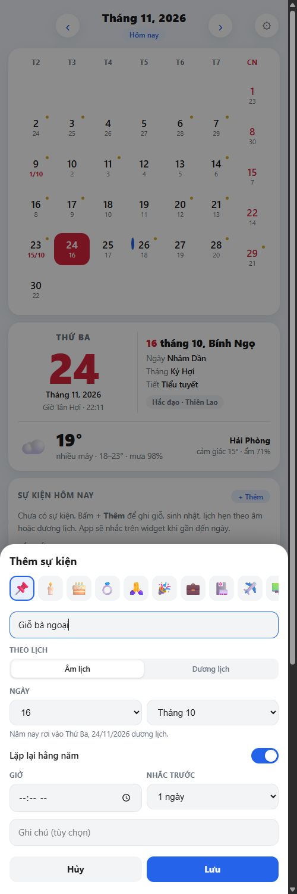
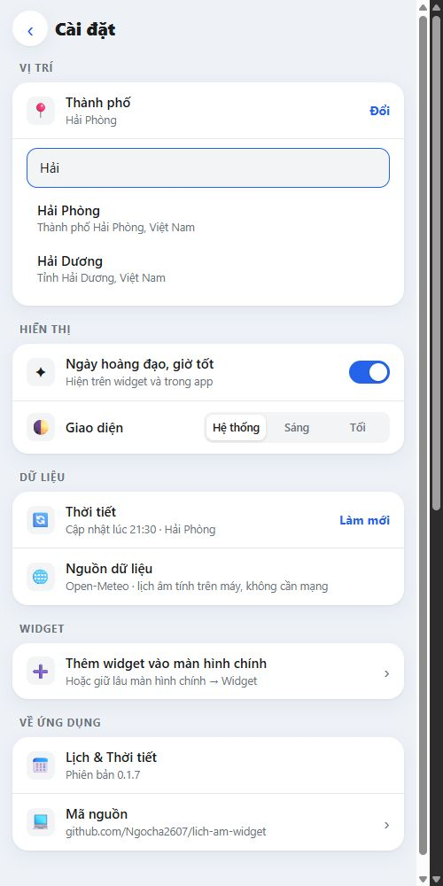

# Lịch âm & Thời tiết — widget Android

Widget cho màn hình chính Android hiện cùng lúc lịch âm, thời tiết và một dòng gợi ý hôm nay nên làm gì. Kèm app xem ngày, sự kiện âm/dương lịch và nhắc việc. Không quảng cáo, không tài khoản, dữ liệu nằm trên máy.

Lịch âm tính offline theo thuật toán Hồ Ngọc Đức. Thời tiết lấy từ Open-Meteo (miễn phí, không cần key).

## Xem trước

Widget 4×2 ở 5 trạng thái (đêm, sáng sớm ngày rằm, ban ngày, chiều tà, trời mưa):


Màn hình app (số liệu thời tiết là mẫu):

| Màn hình chính | Thêm sự kiện | Cài đặt |
|---|---|---|
|  |  |  |

## Tính năng

**Widget**
- Ba cỡ: 2×2 (ngày âm + nhiệt độ), 4×2 (thêm gợi ý), 4×4 (thêm dự báo 3 ngày và sự kiện sắp tới). Kéo giãn widget là tự đổi bố cục (Android 12+ do launcher chọn theo kích thước thật).
- Qua 0h widget tự đổi sang ngày mới (không đánh thức máy, vẽ lại khi bạn mở màn hình).
- Nền gradient đổi theo giờ mặt trời mọc/lặn của thành phố đã chọn (đêm, sáng sớm, ban ngày, chiều tà) và chuyển xám xanh khi mưa.
- Dòng ngày âm nổi bật kèm tuần trăng 🌒🌕🌘; ngày rằm, mùng 1, lễ Tết đổi chữ vàng; đếm ngược Tết trong 90 ngày cuối năm.
- Dòng gợi ý theo thứ tự ưu tiên: sự kiện cá nhân → cảnh báo thời tiết → rằm/mùng 1/lễ → tiết khí → hoàng đạo. Sau 18h nói về ngày mai.
- Chạm vào nhiệt độ mở thẳng thẻ thời tiết, chạm phần còn lại mở lịch.

**Màn hình app**
- Lưới tháng có ngày âm dưới ngày dương, chấm vàng ngày hoàng đạo, chấm xanh ngày có sự kiện; thu gọn thành một hàng tuần được.
- Thẻ ngày: số ngày lớn, giờ can chi hiện tại, ngày/tháng/năm can chi, tiết khí, hoàng/hắc đạo, tuần trăng, hợp/xung với tuổi bạn (nếu đã nhập năm sinh).
- Sự kiện: giỗ, sinh nhật, lịch hẹn theo âm hoặc dương lịch, lặp hằng năm, giờ, nhắc trước. Chọn ngày âm thì hiện luôn rơi vào ngày dương nào; giỗ 30 âm gặp tháng thiếu tự tính vào 29.
- Thời tiết 7 ngày: đường nhiệt độ cao nhất/thấp nhất, UV, cảm giác, độ ẩm, gió (hướng + cấp Beaufort), áp suất, tầm nhìn, thanh bình minh–hoàng hôn. Lưu nhiều thành phố, chuyển bằng chip.
- Gợi ý hôm nay / cho ngày mai.
- Xem ngày: trực (thập nhị kiến trừ) với việc nên làm, không nên; sao Nhị thập bát tú (tốt/xấu, nên/kỵ); ngũ hành nạp âm; tuổi xung; hướng xuất hành (Hỷ thần, Tài thần); giờ xuất hành Lục Diệu.
- Chọn ngày tốt: cưới hỏi, khai trương, khởi công, nhập trạch, ký hợp đồng, mua xe, xuất hành, cúng lễ — chấm điểm theo hoàng đạo, trực, Lục Diệu, sao Nhị thập bát tú, loại ngày trực xấu và ngày xung tuổi.
- Đếm ngược Tết; đổi lịch âm ↔ dương; chia sẻ ảnh "Hôm nay" lên Zalo, Facebook.
- Hồ sơ: họ tên và ngày sinh (nhập theo âm hoặc dương lịch, hiện luôn ngày quy đổi). Tuổi can chi tính theo năm âm của ngày sinh, nên người sinh tháng 1–2 trước Tết vẫn đúng tuổi, dùng để xét hợp/xung tuổi. Bật/tắt từng mục hiển thị, chọn giao diện sáng/tối.

**Thông báo**
- Nhắc sự kiện sắp tới vào giờ bạn chọn (mặc định 7:00), nhắc rằm/mùng 1/lễ Tết (hôm trước và đúng ngày), cảnh báo thời tiết ngày mai lúc 20:00 (mưa, dông, rét, nắng nóng).
- ColorOS hay chặn thông báo và chạy nền của app cài ngoài: vào Cài đặt máy → Thông báo và Pin → cho phép app. Trong app có nút "Gửi thông báo thử" để kiểm tra.

**Dữ liệu**
- Sao lưu sự kiện ra file JSON và khôi phục lại.
- Xuất sự kiện sang Google Calendar bằng file .ics (mỗi lần diễn ra trong 5 năm là một mục, vì Google Calendar không lặp theo âm lịch).

## Build APK bằng GitHub (không cần cài Android Studio)

1. Tạo repo mới trên GitHub (Public hoặc Private đều được).
2. Đẩy code lên:

   ```bash
   git remote add origin https://github.com/<tên-bạn>/lich-am-widget.git
   git push -u origin main
   ```

3. Vào tab **Actions** của repo, chờ job "Build APK" chạy xong (khoảng 5–8 phút lần đầu).
4. Vào tab **Releases**, tải file `LichThoiTiet.apk` về điện thoại rồi cài.
   Lần đầu ColorOS sẽ hỏi cho phép cài từ nguồn không xác định, bấm cho phép.
5. Giữ lâu trên màn hình chính → Widget → "Lịch âm & Thời tiết", hoặc trong app vào Cài đặt → "Thêm widget vào màn hình chính".

Mỗi lần sửa code và `git push`, GitHub tự build bản mới (sửa `docs/` hay README thì không build). Các bản sau cài đè được lên bản trước vì dùng chung khóa ký.

## Cấu trúc

| File | Vai trò |
|---|---|
| `LunarCalendar.kt` | Đổi dương ↔ âm, can chi, hoàng đạo, giờ tốt, tiết khí, tuần trăng, Tết tiếp theo |
| `Almanac.kt` | Trực ngày, việc nên/kỵ, nạp âm, tuổi hợp/xung, hướng xuất hành, Lục Diệu, chọn ngày tốt |
| `Weather.kt` | Gọi Open-Meteo, lưu đệm theo thành phố, đổi mã thời tiết sang tiếng Việt |
| `SuggestionEngine.kt` | Bảng quy tắc sinh gợi ý theo thứ tự ưu tiên |
| `EventStore.kt` | Sự kiện cá nhân, sao lưu JSON, xuất .ics |
| `Reminders.kt` | Báo thức hằng ngày và thông báo sự kiện / ngày lễ / thời tiết |
| `LichWidget.kt` | Widget ba cỡ và phần vẽ giao diện |
| `WeatherWorker.kt` | Cập nhật thời tiết ở nền (3 giờ/lần) |
| `ShareCard.kt` | Vẽ ảnh "Hôm nay" để chia sẻ |
| `MainActivity.kt` | WebView + cầu nối `Android.*` cho trang `assets/index.html` |
| `assets/index.html` | Toàn bộ giao diện app (HTML/CSS/JS), xem trước được trên trình duyệt |

## Nguồn tính toán

- Lịch âm, tiết khí: thuật toán của Hồ Ngọc Đức, múi giờ GMT+7.
- Trực ngày (thập nhị kiến trừ): Kiến tại ngày có chi trùng chi tháng, tháng tính theo tiết khí (Lập xuân mở tháng Dần).
- Giờ xuất hành Lục Diệu: tháng Giêng khởi Đại An, đếm tháng rồi đếm ngày rồi đếm giờ (Tý = 1).
- Ngũ hành ngày: nạp âm 60 hoa giáp.
- Hướng xuất hành: Hỷ thần, Tài thần theo can ngày.
- Hợp/xung tuổi: lục xung, tam hợp, lục hợp theo chi.
- Nhị thập bát tú: chu kỳ 28 ngày liên tục gắn với tuần (sao Giác luôn vào thứ Năm). Ngày mốc đối chiếu khớp với lichngaytot.com, xemlicham.com, lichvannien.net, licham.vn và hoàng lịch Trung Quốc (值日星宿); tốt/xấu theo xemlicham.com và lichngaytot.com (khớp nhau cả 28 sao). Một vài trang lịch khác (ngaydep.com, chogia.vn) lệch chu kỳ nên không dùng làm mốc.

Chưa có: sao tốt/sao xấu theo Ngọc Hạp thông thư, vì chưa có bảng tra đủ tin cậy để đưa vào. Các mục xem ngày chỉ để tham khảo.

## Lưu ý

- `app/lichthoitiet.keystore` là khóa ký dùng để thử nghiệm, mật khẩu `lichthoitiet`. Khi phát hành lên CH Play thì tạo khóa riêng và không đưa lên repo.
- Nếu widget không tự cập nhật, vào Cài đặt → Pin → chọn app → cho phép chạy nền.
